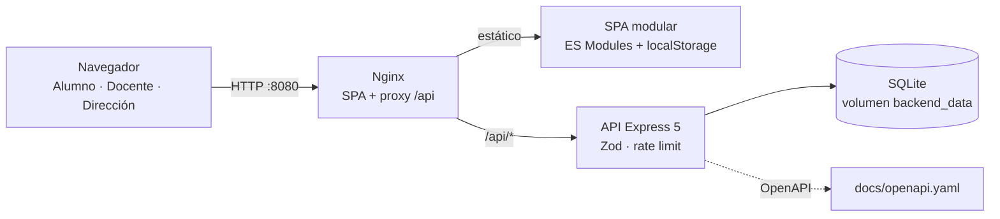

# IntraNerd · Plataforma Escolar Integral

[](.github/workflows/ci.yml)
[](https://nodejs.org)
[](https://nodejs.org/api/sqlite.html)
[](https://docs.docker.com/compose/)
[](docs/openapi.yaml)

IntraNerd es el núcleo de gestión de una comunidad escolar. Reúne en una sola
plataforma los módulos del establecimiento: notas semestrales, talleres,
personas extraviadas, valoración de profesores, objetos perdidos, calendario de
evaluaciones, comunicados, tareas, mensajes internos, menú semanal y
contacto/soporte.

La aplicación es una **SPA offline-first**: toda la información se guarda en
`localStorage`, por lo que funciona sin conexión y sin depender de un servidor.
El repositorio incluye una **API REST** (Express 5 + SQLite) con su propia
suite de pruebas y una especificación OpenAPI.

---

## Módulos

| #   | Módulo                        | Capacidades                                                                                                     |
| --- | ----------------------------- | --------------------------------------------------------------------------------------------------------------- |
| 1   | **Notas y promedios**         | Asignaturas dinámicas, notas por semestre (1.0–7.0), promedio final, indicadores verde/rojo y simulador de meta |
| 2   | **Talleres**                  | Catálogo, horarios, lugares, docentes, inscripción con control de cupos y lista de espera visual                |
| 3   | **Personas extraviadas**      | Reportes de emergencia, foto local o de ejemplo, filtros, marcar encontrado y eliminar                          |
| 4   | **Calificador de profesores** | Directorio por asignatura, estrellas 1–5, opiniones, evidencias, promedio y contador de valoraciones            |
| 5   | **Objetos perdidos**          | Paneles "Encontrados" y "Avisos", categorías, miniaturas, coincidencias sugeridas, resolución y eliminación     |
| 6   | **Calendario escolar**        | Navegación anual, feriados chilenos, selector de rol, eventos por día con autor                                 |
| 7   | **Comunicados**               | Feed oficial, fijado de anuncios, categorías y autoría                                                          |
| 8   | **Tareas**                    | Publicación por asignatura, fechas de entrega y checklist personal por alumno                                   |
| 9   | **Mensajes internos**         | Directorio de contactos, alta de profesores/alumnos/inspectores y conversaciones locales                        |
| 10  | **Menú semanal**              | Rotación automática por semana, detalle por día, alérgenos, comentarios y sugerencias                           |
| 11  | **Contacto y soporte**        | Formulario accesible, API + respaldo local, canales directos y enlace a la solución tecnológica (OpenAPI)       |

El **panel general** añade un plan semanal que combina tareas y evaluaciones
para proponer bloques de estudio. Las coincidencias de objetos y el simulador
de notas son reglas locales y explicables: no envían datos a servicios de IA.

El **footer institucional** reúne la navegación secundaria, el centro de
accesibilidad, los canales de contacto y los documentos legales: aviso legal,
términos, privacidad, cookies, seguridad y accesibilidad.

---

## Documentación

| Documento                                      | Para quién                           | Contenido                                                                       |
| ---------------------------------------------- | ------------------------------------ | ------------------------------------------------------------------------------- |
| [`docs/GUIA-EQUIPO.md`](docs/GUIA-EQUIPO.md)   | Equipo de la escuela y principiantes | HTML, CSS, tipografías, iconos, funciones, SPA, localStorage y flujo de trabajo |
| [`docs/ARCHITECTURE.md`](docs/ARCHITECTURE.md) | Desarrollo                           | Capas, decisiones, modelo de datos, flujos y pruebas                            |
| [`docs/DEPLOYMENT.md`](docs/DEPLOYMENT.md)     | Infraestructura                      | Despliegue, variables, respaldos y operación                                    |
| [`docs/openapi.yaml`](docs/openapi.yaml)       | Integraciones                        | Contrato REST completo de la plataforma                                         |

La guía del equipo está escrita para quienes nunca han usado HTML: explica
cada concepto desde cero y termina con un tutorial para agregar un módulo nuevo
a la SPA.

---

## Arquitectura



- **Frontend:** SPA sin bundler, módulos ES nativos, CSS modular con tokens y
  diseño responsive. Persistencia local con espacio de nombres versionado,
  migración de los prototipos antiguos y fallback en memoria si la cuota se agota.
- **Backend:** Express 5, validación con Zod, SQLite nativo
  (`node:sqlite`), parser multipart propio, rate limiting y manejo central de
  errores. No implementa autenticación: la identidad de autoría es el perfil
  local de la SPA.
- **Base de datos:** archivo SQLite con WAL, claves foráneas y restricciones
  `CHECK` para escala de notas, roles, estados y cupos. Se persiste en el
  volumen Docker `backend_data`.
- **Entrega:** build multi-stage, Nginx como reverse proxy, healthchecks,
  usuario no-root en la API y cabeceras de seguridad.

### Estructura del repositorio

```text
.
├── index.html                 # Shell de la SPA
├── src/                       # SPA modular (vistas, componentes, estilos, servicios)
│   ├── components/            # Componentes reutilizables
│   ├── data/                  # Constantes, catálogos y seeds locales
│   ├── services/              # storage, HTTP, API, sesión y repositorios
│   ├── styles/                # CSS modular (tokens, layout, vistas)
│   └── utils/                 # DOM, formato, fechas, archivos
├── assets/                    # Marca SVG, mascotas WebP, fuente Inter e ilustraciones
│   ├── brand/                 # Logo claro/inverso y favicon
│   ├── mascots/               # Nerdi (oficial) y alternativas conservadas
│   └── fonts/                 # Inter variable autoalojada (OFL)
├── backend/
│   ├── src/
│   │   ├── db/                # Conexión, schema.sql, migración y seed
│   │   ├── routes/            # Un router por módulo
│   │   ├── controllers/       # Capa HTTP
│   │   ├── services/          # Reglas de negocio
│   │   ├── repositories/      # SQL preparado
│   │   ├── validators/        # Esquemas Zod
│   │   ├── app.js             # Composición de Express
│   │   └── server.js          # Arranque y apagado ordenado
│   ├── tests/api.test.js      # Integración con node:test
│   └── Dockerfile
├── frontend/                  # Build, dev server, Nginx y Dockerfile de la SPA
├── tests/                     # unit / integration / e2e
├── docs/
│   ├── GUIA-EQUIPO.md         # Guía de aprendizaje para el equipo
│   ├── ARCHITECTURE.md        # Decisiones técnicas y flujos
│   ├── DEPLOYMENT.md          # Operación y despliegue
│   └── openapi.yaml           # Especificación OpenAPI 3.0.3
├── scripts/lint.mjs           # Guardrails de código
├── docker-compose.yml
├── Makefile
└── .env.example
```

---

## Inicio rápido con Docker

Requisitos: Docker Engine 24+ y Docker Compose v2.

```bash
git clone https://github.com/grubberdubber/intranerd.git
cd intranerd
cp .env.example .env
docker compose up -d --build
```

| Servicio        | URL                                   |
| --------------- | ------------------------------------- |
| Aplicación      | <http://localhost:8080>               |
| API (directa)   | <http://localhost:4000/api/v1/health> |
| API (vía Nginx) | <http://localhost:8080/api/v1/health> |

```bash
docker compose ps                 # estado y healthchecks
docker compose logs -f backend    # logs de la API
docker compose down               # detener (conserva datos)
docker compose down -v            # eliminar también los volúmenes
```

La SPA usa la API cuando responde y degrada a `localStorage` ante fallos de red,
404 o 5xx; los errores de validación sí se muestran. Los adaptadores de
`src/services/resources.js` traducen el contrato REST al modelo de las vistas.

Al arrancar, la API crea el esquema de forma idempotente y carga datos demo si
`SEED_ON_START=true`. Para producción usa `SEED_ON_START=false`.

### Respaldos de SQLite

El perfil `backup` copia la base a `./backups/` sin detener la API:

```bash
docker compose --profile backup run --rm db-backup
```

---

## Desarrollo local

Requisitos: Node.js 24+ y pnpm 12+ (no hace falta PostgreSQL ni Docker).

```bash
# 1. Dependencias del workspace (raíz + backend)
pnpm install

# 2. Variables del backend (opcional; los valores por defecto ya funcionan)
cp backend/.env.example backend/.env

# 3. API en :4000 (crea y siembra SQLite automáticamente)
pnpm dev:api

# 4. SPA en :5173 con proxy /api → :4000
pnpm dev
```

Para una demostración temporal solo necesitas el paso 1 y `pnpm dev`: si la API
no está levantada, la SPA usa `localStorage` después del timeout de conexión.
Abre <http://localhost:5173>. Si el puerto está ocupado, usa `PORT=5174 pnpm dev`.

La SPA también puede abrirse como sitio estático: al no depender de un bundler,
basta servir la raíz del repositorio (`python3 -m http.server 8080`).

### Variables de entorno

| Variable             | Default              | Descripción                                  |
| -------------------- | -------------------- | -------------------------------------------- |
| `NODE_ENV`           | `development`        | `development`, `test` o `production`         |
| `PORT`               | `4000`               | Puerto de la API                             |
| `DATABASE_PATH`      | `data/intranerd.db`  | Archivo SQLite (relativo a `backend/`)       |
| `SEED_ON_START`      | `true` en desarrollo | Carga datos demo si la base está vacía       |
| `UPLOAD_DIR`         | `uploads`            | Carpeta de archivos subidos                  |
| `MAX_UPLOAD_MB`      | `10`                 | Tamaño máximo por archivo                    |
| `CORS_ORIGINS`       | `*`                  | Orígenes permitidos, separados por comas     |
| `RATE_LIMIT_MAX`     | `300`                | Peticiones por IP por minuto (`0` desactiva) |
| `APP_PORT`           | `8080`               | Puerto público del frontend (Docker)         |
| `API_PORT`           | `4000`               | Puerto de la API en el host (Docker)         |
| `INTRANERD_API_BASE` | `/api`               | Base inyectada en el build de la SPA         |

En Docker, `DATABASE_PATH=/app/data/intranerd.db` y el volumen `backend_data`
conserva la base entre reinicios.

---

## API REST

La especificación completa está en [`docs/openapi.yaml`](docs/openapi.yaml)
(OpenAPI 3.0.3, 34 rutas). Base canónica: `/api/v1`; alias sin versión: `/api`.
La SPA también sirve esa especificación en `/docs/openapi.yaml` para que el
enlace “Ver la solución tecnológica” del módulo de contacto funcione en
producción.

```bash
curl -s http://localhost:4000/api/v1/health | jq
curl -s http://localhost:4000/api/v1/workshops | jq
```

| Grupo      | Endpoints principales                                                       |
| ---------- | --------------------------------------------------------------------------- |
| Salud      | `GET /health`                                                               |
| Notas      | `GET /grades`, `POST /grades/subjects`, `POST /grades/subjects/{id}/grades` |
| Talleres   | `GET/POST /workshops`, `POST /workshops/{id}/enrollments`                   |
| Seguridad  | `GET/POST /missing-persons`, `PATCH /missing-persons/{id}/status`           |
| Profesores | `GET/POST /teachers`, `POST /teachers/{id}/reviews`                         |
| Objetos    | `GET/POST /lost-found`, `PATCH /lost-found/{id}/status`                     |
| Calendario | `GET /calendar`, `GET/POST /calendar/events`, `GET /calendar/holidays`      |
| Anuncios   | `GET/POST /announcements`, `PATCH /announcements/{id}/pin`                  |
| Tareas     | `GET/POST /tasks`, `PATCH /tasks/{id}/completion`                           |
| Contacto   | `POST /contact` (sin listado público; confirma recepción)                   |

Todas las respuestas usan una envoltura uniforme:

```json
{ "success": true, "data": {}, "error": null }
```

```json
{
  "success": false,
  "data": null,
  "error": "Datos de entrada inválidos.",
  "details": [{ "field": "value", "message": "La nota máxima es 7.0" }]
}
```

Códigos: `200/201` éxito, `400` petición mal formada, `404` recurso,
`409` conflicto o cupo lleno, `413` payload, `422` validación, `429` rate limit,
`500` error interno. Los listados se paginan con `?page=1&limit=20`.

> La API no implementa autenticación en esta versión. No la expongas
> directamente a Internet sin añadir JWT/sesiones y autorización por rol.

---

## Pruebas

```bash
pnpm test                  # 395 pruebas Vitest (222 unitarias + 173 de integración) con cobertura
pnpm test:unit             # 222 pruebas unitarias
pnpm test:integration      # 173 pruebas de API (SQLite temporal)
pnpm test:e2e              # 15 flujos Playwright (Chromium de escritorio + móvil)
pnpm test:backend          # 11 pruebas del backend con node:test
```

- **Unitarias:** reglas de notas, formato/fechas, feriados, validadores,
  almacenamiento y migraciones.
- **Integración:** API real con SQLite temporal y Supertest.
- **E2E:** navegación, altas, persistencia y responsive con `data-testid`.
- **Backend:** suite HTTP propia con `node:test`.

CI ejecuta formato, lint, tests, Playwright y build de imágenes en cada push.

---

## Marca, mascota y tipografía

- **Marca:** `assets/brand/intranerd-mark.svg` (libro abierto + gafas) para
  fondos claros, `intranerd-mark-inverse.svg` para el sidebar azul y
  `favicon.svg` para la pestaña. Los logos originales quedan en
  `assets/brand/source/`.
- **Mascota:** **Nerdi**, el búho, se usa en el panel general y en la vista de
  contacto (`assets/mascots/nerdi.webp`). El niño y el robot de la lámina
  original se conservan en `assets/mascots/alternativas/` para futuras campañas.
- **Tipografía:** Inter variable, autoalojada en `assets/fonts/` y declarada en
  `src/styles/fonts.css` con `font-display: swap`. **No se carga Google Fonts en
  tiempo de ejecución**: no hay peticiones a `fonts.googleapis.com` ni
  `fonts.gstatic.com`, ni cookies de terceros. La licencia OFL se conserva en
  `assets/fonts/OFL.txt`.
- **Accesibilidad:** objetivo WCAG 2.2 AA: navegación completa por teclado, foco
  visible, contraste AA, regiones vivas, formularios con errores asociados,
  `prefers-reduced-motion` y textos alternativos. El **Centro de accesibilidad**
  (barra superior y footer) permite ampliar el texto, activar alto contraste y
  reducir el movimiento; la elección persiste en `intranerd.v2:ui.preferences`.
  La declaración completa está en el footer y el módulo de contacto permite
  reportar barreras.

---

## Calidad de código

```bash
pnpm lint       # Prettier --check + guardrails propios
pnpm format     # Prettier --write
```

Prettier fija el estilo (100 columnas, comillas simples, trailing commas).
`scripts/lint.mjs` añade reglas que un formateador no cubre: `eval`,
`new Function`, `debugger`, igualdad laxa, `var`, longitud de línea, sintaxis
(`node --check`), finales LF y marcadores TODO.

---

## Pie de página, privacidad y cookies

El footer se monta una sola vez en el layout (`src/components/footer.js`) y
aparece al final de todos los módulos. Incluye navegación secundaria, recursos
para el equipo, canales de contacto y accesos a los documentos legales.

- **Textos legales:** `src/data/legal.js` (términos, privacidad, cookies y
  declaración de accesibilidad, con versión y fecha). Los modales se abren sin
  salir de la SPA.
- **Consentimiento:** el banner inicial se muestra solo si no hay una decisión
  guardada. La elección vive en `intranerd.v2:legal.cookieConsent` y puede
  revisarse o retirarse desde "Preferencias de cookies" en el footer.
- **Sin rastreo:** no hay cookies publicitarias, analítica ni peticiones a
  dominios externos. La política lo declara de forma explícita.

Para volver a probar el aviso desde la consola del navegador:

```js
localStorage.removeItem('intranerd.v2:legal.cookieConsent');
location.reload();
```

Los textos son un borrador de proyecto escolar y requieren revisión de la
dirección antes de publicar la plataforma fuera del establecimiento.

---

## Seguridad

- Sin credenciales, tokens ni claves en el repositorio; `.env` está ignorado.
- Validación estricta de entrada con Zod y consultas SQL parametrizadas.
- Rate limit por IP y cabeceras `nosniff`, `DENY`, Referrer-Policy,
  Permissions-Policy y CSP en Nginx.
- Subidas con nombre aleatorio, allowlist de MIME y límite de tamaño; SVG
  rechazado a propósito.
- Límite de payload y usuario no-root en la API.
- La SPA guarda datos solo en el navegador: no hay cuentas ni contraseñas.

Para producción: usa HTTPS en el proxy externo, define `CORS_ORIGINS` con tu
dominio, desactiva `SEED_ON_START` y no publiques el puerto `4000` fuera de
loopback.

---

## Comandos útiles

| Comando                            | Acción                           |
| ---------------------------------- | -------------------------------- |
| `make up` / `make down`            | Levantar / detener Docker        |
| `make logs` / `make ps`            | Logs / estado                    |
| `make dev` / `make dev-api`        | SPA / API en desarrollo          |
| `make test` / `make lint`          | Calidad                          |
| `make db-migrate` / `make db-seed` | Base de datos SQLite             |
| `make backup`                      | Copia de seguridad de SQLite     |
| `make clean`                       | Elimina contenedores y volúmenes |

---

## Solución de problemas

| Síntoma                 | Causa / solución                                                       |
| ----------------------- | ---------------------------------------------------------------------- |
| La API no arranca       | Revisa `docker compose logs backend`; Node debe ser 24+                |
| La SPA no guarda datos  | El navegador bloquea `localStorage`; revisa la cuota o el modo privado |
| `413 Payload Too Large` | Aumenta `MAX_UPLOAD_MB` o reduce la imagen                             |
| CORS bloqueado          | Añade el origen exacto a `CORS_ORIGINS`                                |
| La base no persiste     | No uses `docker compose down -v`; conserva `backend_data`              |

Los prototipos originales en HTML se conservan en [`legacy/`](legacy) como
referencia histórica.

---

## Licencia

MIT. Consulta el archivo [`LICENSE`](LICENSE) si está disponible en el
repositorio.
