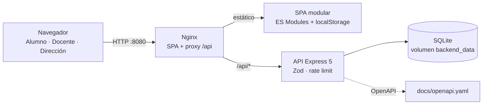

# IntraNerd · Plataforma Escolar Integral

[](.github/workflows/ci.yml)
[](https://nodejs.org)
[](https://nodejs.org/api/sqlite.html)
[](https://docs.docker.com/compose/)
[](docs/openapi.yaml)

IntraNerd es el núcleo de gestión de una comunidad escolar. Reúne en una sola
plataforma los ocho módulos del establecimiento: notas semestrales, talleres,
personas extraviadas, valoración de profesores, objetos perdidos, calendario de
evaluaciones, comunicados y tareas.

La aplicación es una **SPA offline-first**: toda la información se guarda en
`localStorage`, por lo que funciona sin conexión y sin depender de un servidor.
El repositorio incluye una **API REST** (Express 5 + SQLite) con su propia
suite de pruebas y una especificación OpenAPI.

---

## Módulos

| #   | Módulo                        | Capacidades                                                                                                |
| --- | ----------------------------- | ---------------------------------------------------------------------------------------------------------- |
| 1   | **Notas y promedios**         | Asignaturas dinámicas, notas por semestre (1.0–7.0), promedio por semestre y final, indicadores verde/rojo |
| 2   | **Talleres**                  | Catálogo, horarios, lugares, docentes, inscripción con control de cupos y lista de espera visual           |
| 3   | **Personas extraviadas**      | Reportes de emergencia, foto local o de ejemplo, filtros, marcar encontrado y eliminar                     |
| 4   | **Calificador de profesores** | Directorio por asignatura, estrellas 1–5, opiniones, evidencias, promedio y contador de valoraciones       |
| 5   | **Objetos perdidos**          | Paneles "Encontrados" y "Avisos", categorías, miniaturas, resolución y eliminación                         |
| 6   | **Calendario escolar**        | Navegación anual, feriados chilenos, selector de rol, eventos por día con autor                            |
| 7   | **Comunicados**               | Feed oficial, fijado de anuncios, categorías y autoría                                                     |
| 8   | **Tareas**                    | Publicación por asignatura, fechas de entrega y checklist personal por alumno                              |

---

## Arquitectura



- **Frontend:** SPA sin bundler, módulos ES nativos, CSS modular con tokens y
  diseño responsive. Persistencia local con espacio de nombres versionado,
  migración de los prototipos antiguos y fallback en memoria si la cuota se agota.
- **Backend:** Express 5, validación con Zod, SQLite nativo
  (`node:sqlite`), parser multipart propio, rate limiting y manejo central de
  errores. No implementa autenticación: la identidad de autoría es el perfil
  local de la SPA.
- **Base de datos:** archivo SQLite con WAL, claves foráneas y restricciones
  `CHECK` para escala de notas, roles, estados y cupos. Se persiste en el
  volumen Docker `backend_data`.
- **Entrega:** build multi-stage, Nginx como reverse proxy, healthchecks,
  usuario no-root en la API y cabeceras de seguridad.

### Estructura del repositorio

```text
.
├── index.html                 # Shell de la SPA
├── src/                       # SPA modular (vistas, componentes, estilos, servicios)
│   ├── components/            # Componentes reutilizables
│   ├── data/                  # Constantes, catálogos y seeds locales
│   ├── services/              # storage, HTTP, API, sesión y repositorios
│   ├── styles/                # CSS modular (tokens, layout, vistas)
│   └── utils/                 # DOM, formato, fechas, archivos
├── assets/                    # Ilustraciones, avatares y miniaturas SVG
├── backend/
│   ├── src/
│   │   ├── db/                # Conexión, schema.sql, migración y seed
│   │   ├── routes/            # Un router por módulo
│   │   ├── controllers/       # Capa HTTP
│   │   ├── services/          # Reglas de negocio
│   │   ├── repositories/      # SQL preparado
│   │   ├── validators/        # Esquemas Zod
│   │   ├── app.js             # Composición de Express
│   │   └── server.js          # Arranque y apagado ordenado
│   ├── tests/api.test.js      # Integración con node:test
│   └── Dockerfile
├── frontend/                  # Build, dev server, Nginx y Dockerfile de la SPA
├── tests/                     # unit / integration / e2e
├── docs/openapi.yaml          # Especificación OpenAPI 3.0.3
├── scripts/lint.mjs           # Guardrails de código
├── docker-compose.yml
├── Makefile
└── .env.example
```

---

## Inicio rápido con Docker

Requisitos: Docker Engine 24+ y Docker Compose v2.

```bash
git clone https://github.com/grubberdubber/intranerd.git
cd intranerd
cp .env.example .env
docker compose up -d --build
```

| Servicio        | URL                                   |
| --------------- | ------------------------------------- |
| Aplicación      | <http://localhost:8080>               |
| API (directa)   | <http://localhost:4000/api/v1/health> |
| API (vía Nginx) | <http://localhost:8080/api/v1/health> |

```bash
docker compose ps                 # estado y healthchecks
docker compose logs -f backend    # logs de la API
docker compose down               # detener (conserva datos)
docker compose down -v            # eliminar también los volúmenes
```

La SPA usa la API cuando responde y degrada a `localStorage` ante fallos de red,
404 o 5xx; los errores de validación sí se muestran. Los adaptadores de
`src/services/resources.js` traducen el contrato REST al modelo de las vistas.

Al arrancar, la API crea el esquema de forma idempotente y carga datos demo si
`SEED_ON_START=true`. Para producción usa `SEED_ON_START=false`.

### Respaldos de SQLite

El perfil `backup` copia la base a `./backups/` sin detener la API:

```bash
docker compose --profile backup run --rm db-backup
```

---

## Desarrollo local

Requisitos: Node.js 24+ (no hace falta PostgreSQL ni Docker).

```bash
# 1. Dependencias
npm install
npm --prefix backend install

# 2. Variables del backend (opcional; los valores por defecto ya funcionan)
cp backend/.env.example backend/.env

# 3. API en :4000 (crea y siembra SQLite automáticamente)
npm run dev:api

# 4. SPA en :5173 con proxy /api → :4000
npm run dev
```

La SPA también puede abrirse como sitio estático: al no depender de un bundler,
basta servir la raíz del repositorio (`python3 -m http.server 8080`).

### Variables de entorno

| Variable             | Default              | Descripción                                  |
| -------------------- | -------------------- | -------------------------------------------- |
| `NODE_ENV`           | `development`        | `development`, `test` o `production`         |
| `PORT`               | `4000`               | Puerto de la API                             |
| `DATABASE_PATH`      | `data/intranerd.db`  | Archivo SQLite (relativo a `backend/`)       |
| `SEED_ON_START`      | `true` en desarrollo | Carga datos demo si la base está vacía       |
| `UPLOAD_DIR`         | `uploads`            | Carpeta de archivos subidos                  |
| `MAX_UPLOAD_MB`      | `10`                 | Tamaño máximo por archivo                    |
| `CORS_ORIGINS`       | `*`                  | Orígenes permitidos, separados por comas     |
| `RATE_LIMIT_MAX`     | `300`                | Peticiones por IP por minuto (`0` desactiva) |
| `APP_PORT`           | `8080`               | Puerto público del frontend (Docker)         |
| `API_PORT`           | `4000`               | Puerto de la API en el host (Docker)         |
| `INTRANERD_API_BASE` | `/api`               | Base inyectada en el build de la SPA         |

En Docker, `DATABASE_PATH=/app/data/intranerd.db` y el volumen `backend_data`
conserva la base entre reinicios.

---

## API REST

La especificación completa está en [`docs/openapi.yaml`](docs/openapi.yaml)
(OpenAPI 3.0.3, 33 rutas). Base canónica: `/api/v1`; alias sin versión: `/api`.

```bash
curl -s http://localhost:4000/api/v1/health | jq
curl -s http://localhost:4000/api/v1/workshops | jq
```

| Grupo      | Endpoints principales                                                       |
| ---------- | --------------------------------------------------------------------------- |
| Salud      | `GET /health`                                                               |
| Notas      | `GET /grades`, `POST /grades/subjects`, `POST /grades/subjects/{id}/grades` |
| Talleres   | `GET/POST /workshops`, `POST /workshops/{id}/enrollments`                   |
| Seguridad  | `GET/POST /missing-persons`, `PATCH /missing-persons/{id}/status`           |
| Profesores | `GET/POST /teachers`, `POST /teachers/{id}/reviews`                         |
| Objetos    | `GET/POST /lost-found`, `PATCH /lost-found/{id}/status`                     |
| Calendario | `GET /calendar`, `GET/POST /calendar/events`, `GET /calendar/holidays`      |
| Anuncios   | `GET/POST /announcements`, `PATCH /announcements/{id}/pin`                  |
| Tareas     | `GET/POST /tasks`, `PATCH /tasks/{id}/completion`                           |

Todas las respuestas usan una envoltura uniforme:

```json
{ "success": true, "data": {}, "error": null }
```

```json
{
  "success": false,
  "data": null,
  "error": "Datos de entrada inválidos.",
  "details": [{ "field": "value", "message": "La nota máxima es 7.0" }]
}
```

Códigos: `200/201` éxito, `400` petición mal formada, `404` recurso,
`409` conflicto o cupo lleno, `413` payload, `422` validación, `429` rate limit,
`500` error interno. Los listados se paginan con `?page=1&limit=20`.

> La API no implementa autenticación en esta versión. No la expongas
> directamente a Internet sin añadir JWT/sesiones y autorización por rol.

---

## Pruebas

```bash
npm test                  # Vitest: unitarias + integración con cobertura
npm run test:unit         # 178 pruebas unitarias
npm run test:integration  # 170 pruebas de API (SQLite temporal)
npm run test:e2e          # 10 flujos Playwright (Chromium + móvil)
npm --prefix backend test # 10 pruebas del backend con node:test
```

- **Unitarias:** reglas de notas, formato/fechas, feriados, validadores,
  almacenamiento y migraciones.
- **Integración:** API real con SQLite temporal y Supertest.
- **E2E:** navegación, altas, persistencia y responsive con `data-testid`.
- **Backend:** suite HTTP propia con `node:test`.

CI ejecuta formato, lint, tests, Playwright y build de imágenes en cada push.

---

## Calidad de código

```bash
npm run lint       # Prettier --check + guardrails propios
npm run format     # Prettier --write
```

Prettier fija el estilo (100 columnas, comillas simples, trailing commas).
`scripts/lint.mjs` añade reglas que un formateador no cubre: `eval`,
`new Function`, `debugger`, igualdad laxa, `var`, longitud de línea, sintaxis
(`node --check`), finales LF y marcadores TODO.

---

## Seguridad

- Sin credenciales, tokens ni claves en el repositorio; `.env` está ignorado.
- Validación estricta de entrada con Zod y consultas SQL parametrizadas.
- Rate limit por IP y cabeceras `nosniff`, `DENY`, Referrer-Policy,
  Permissions-Policy y CSP en Nginx.
- Subidas con nombre aleatorio, allowlist de MIME y límite de tamaño; SVG
  rechazado a propósito.
- Límite de payload y usuario no-root en la API.
- La SPA guarda datos solo en el navegador: no hay cuentas ni contraseñas.

Para producción: usa HTTPS en el proxy externo, define `CORS_ORIGINS` con tu
dominio, desactiva `SEED_ON_START` y no publiques el puerto `4000` fuera de
loopback.

---

## Comandos útiles

| Comando                            | Acción                           |
| ---------------------------------- | -------------------------------- |
| `make up` / `make down`            | Levantar / detener Docker        |
| `make logs` / `make ps`            | Logs / estado                    |
| `make dev` / `make dev-api`        | SPA / API en desarrollo          |
| `make test` / `make lint`          | Calidad                          |
| `make db-migrate` / `make db-seed` | Base de datos SQLite             |
| `make backup`                      | Copia de seguridad de SQLite     |
| `make clean`                       | Elimina contenedores y volúmenes |

---

## Solución de problemas

| Síntoma                 | Causa / solución                                                       |
| ----------------------- | ---------------------------------------------------------------------- |
| La API no arranca       | Revisa `docker compose logs backend`; Node debe ser 24+                |
| La SPA no guarda datos  | El navegador bloquea `localStorage`; revisa la cuota o el modo privado |
| `413 Payload Too Large` | Aumenta `MAX_UPLOAD_MB` o reduce la imagen                             |
| CORS bloqueado          | Añade el origen exacto a `CORS_ORIGINS`                                |
| La base no persiste     | No uses `docker compose down -v`; conserva `backend_data`              |

Los prototipos originales en HTML se conservan en [`legacy/`](legacy) como
referencia histórica.

---

## Licencia

MIT. Consulta el archivo [`LICENSE`](LICENSE) si está disponible en el
repositorio.
