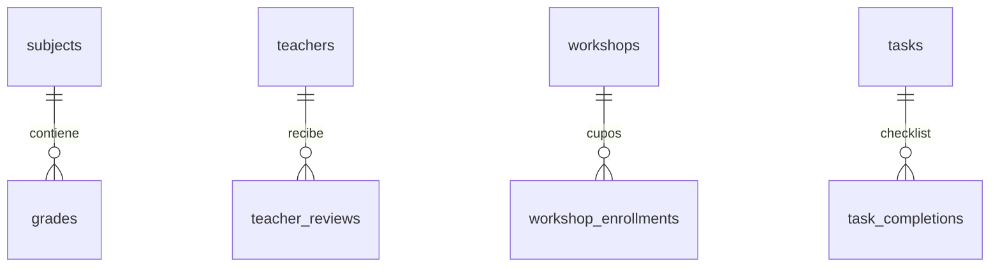
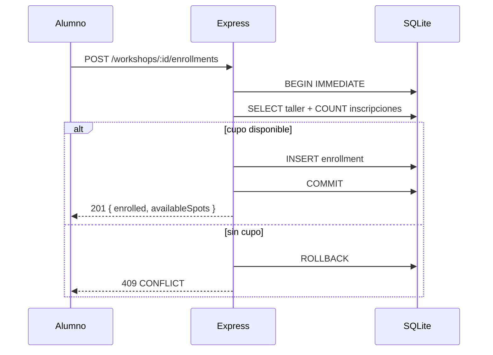

# Arquitectura de IntraNerd

Documento técnico de integración. Complementa al [README](../README.md) y a la
[especificación OpenAPI](openapi.yaml).

## 1. Visión general

IntraNerd se compone de una SPA estática y una API REST opcional. La SPA es la
fuente de experiencia y persiste en el navegador; la API ofrece una base
compartida para integraciones y pruebas de contrato.

```text
┌──────────────────────────────────────────────────────────────────┐
│ Navegador                                                        │
│  SPA ES Modules · CSS modular · localStorage (offline-first)      │
└───────────────┬──────────────────────────────────────────────────┘
                │ HTTP 80/443
┌───────────────▼──────────────────────────────────────────────────┐
│ Nginx                                                            │
│  · Sirve index.html, src/ y assets/                             │
│  · Fallback SPA (try_files)                                      │
│  · Proxy /api → backend:4000                                     │
│  · CSP, gzip, caché y límites de payload                         │
└───────────────┬──────────────────────────────────────────────────┘
                │ HTTP interno
┌───────────────▼──────────────────────────────────────────────────┐
│ API Express 5                                                    │
│  Routers → controladores → servicios → repositorios SQLite       │
│  Zod · rate limit · multipart propio · errores uniformes         │
└───────────────┬──────────────────────────────────────────────────┘
                │ archivo + WAL
┌───────────────▼──────────────────────────────────────────────────┐
│ SQLite (node:sqlite)                                             │
│  Volumen Docker `backend_data` · esquema idempotente · CHECK     │
└──────────────────────────────────────────────────────────────────┘
```

## 2. Decisiones de diseño

| Decisión                          | Motivo                                                              | Consecuencia                                                        |
| --------------------------------- | ------------------------------------------------------------------- | ------------------------------------------------------------------- |
| SPA sin bundler                   | Cero toolchain, arranque inmediato, fácil auditoría                 | No hay tree-shaking; el build solo copia e inyecta configuración    |
| `localStorage` offline-first      | Requisito del producto y operación en aulas con red inestable       | Datos por navegador; no hay sincronización automática entre equipos |
| API REST separada                 | Desacopla la UI de la persistencia y permite datos compartidos      | La SPA usa adaptadores para traducir el contrato REST               |
| SQLite embebido                   | Cero servicios externos, backups por archivo, ideal para un colegio | Un solo escritor; suficiente para el volumen esperado               |
| Imágenes como data URL / archivos | Funciona offline y no requiere object storage                       | Payload mayor; límites de 2.5–4 MB en la SPA y 10 MB en la API      |
| Express 5                         | Manejo nativo de promesas y router maduro                           | Requiere Node.js 24+                                                |
| Sin autenticación                 | La entrega prioriza los 8 módulos y el modo offline                 | No exponer la API a Internet sin añadir sesiones y roles            |

## 3. Frontend

### Capas

- `src/views/`: una vista por módulo, sin acceso directo a `fetch`.
- `src/components/`: layout, modal, toasts, estrellas, file picker, estados.
- `src/services/`:
  - `storage.js`: prefijo versionado, serialización segura, fallback en memoria
    y evento `intranerd:storage`.
  - `http.js`: timeout, errores tipados y `AbortController`.
  - `api.js`: fábrica de repositorios con doble adaptador REST/localStorage.
  - `session.js`: perfil y rol local para autoría de contenido.
  - `migrate.js`: importa datos de los prototipos antiguos en `legacy/`.
- `src/data/`: catálogos, feriados y seeds de demostración.
- `src/styles/`: tokens, layout y CSS por vista.

### Persistencia

1. La SPA hidrata cada repositorio desde `localStorage` con namespace
   `intranerd.v2:*`.
2. Si la API está habilitada (`config.api.enabled`), cada repositorio intenta
   la operación remota mediante los adaptadores de `services/resources.js`.
3. Los errores de red/5xx degradan a almacenamiento local y se emite el evento
   de conexión para que la UI informe el modo activo.
4. Los errores de negocio (400/409/422) no se ocultan: se muestran al usuario.
5. Si la cuota se agota, `storage.js` lanza un `StorageError` con un mensaje
   accionable en lugar de perder datos silenciosamente.

### Accesibilidad y responsive

- Skip link, roles ARIA, `aria-live` para toasts y foco atrapado en modales.
- Navegación lateral colapsable; grids fluidos y targets táctiles ≥ 44 px.
- Contraste AA sobre la paleta institucional (`#1e40af`, `#2563eb`).

## 4. Backend

### Capas

```text
routes/*.js       → validación Zod y definición HTTP
controllers/*.js  → lectura de req.validated y respuesta
services/*.js     → reglas puras: promedios, cupos, checklist, feriados
repositories/*.js → SQL preparado y mapeo a camelCase
db/connection.js  → DatabaseSync, PRAGMAs y transacciones
middlewares/      → upload, validate, rate limit, seguridad y errores
```

Cada módulo comparte:

- `validate({ params, query, body })`: convierte errores Zod en `422` con
  detalle por campo.
- `transaction(fn)`: escrituras atómicas con `BEGIN IMMEDIATE` (cupos).
- `ApiError`: errores de negocio con código estable.
- `sendSuccess` / `sendError`: envoltura uniforme.

### Contrato de respuestas

- Éxito: `{ success: true, data, error: null }`.
- Error: `{ success: false, data: null, error, details? }`.
- Listados: `data = { items, pagination }`.
- Cabeceras: `X-Request-Id`, `X-Content-Type-Options`, `X-Frame-Options`,
  `Referrer-Policy`, `Permissions-Policy` y HSTS en producción.
- OpenAPI 3.0.3 en `docs/openapi.yaml` (33 rutas).

## 5. Modelo de datos



Tablas principales: `subjects`, `grades`, `missing_persons`, `teachers`,
`teacher_reviews`, `lost_found_items`, `calendar_events`, `workshops`,
`workshop_enrollments`, `announcements`, `tasks`, `task_completions`.

Reglas de integridad:

- `grades.value BETWEEN 1.0 AND 7.0`; `semester IN (1,2)`.
- Unicidad `(workshop_id, student_name)` y `(task_id, student_name)`.
- Estados acotados por `CHECK`: tipo de objeto, estado de reporte, rol del
  calendario, categoría de anuncio y rating 1–5.
- Borrados en cascada en tablas hijas (`grades`, reseñas, inscripciones,
  checklist); las claves primarias son TEXT con prefijo legible.

No hay vistas SQL: los promedios y agregados se calculan en la capa de
servicios para mantener una sola fuente de verdad y facilitar las pruebas.

## 6. Flujos críticos

### Inscripción a taller con cupos



### Registro de nota

1. La SPA agrega la nota al arreglo semestral de la asignatura y persiste en
   `localStorage`.
2. La API expone el flujo equivalente: `POST /grades/subjects` crea la
   asignatura y `POST /grades/subjects/{id}/grades` agrega una entrada.
3. `GET /grades` agrega por asignatura: promedio semestral, promedio final,
   aprobación desde 4.0 y promedio general.
4. La UI muestra indicadores verde/rojo y un resumen por semestre.

### Checklist personal

Cada alumno tiene su propio registro `(task_id, student_name)`; marcar una tarea
no afecta el estado de los demás. La SPA guarda el checklist por perfil local.

## 7. Pruebas

| Nivel       | Herramienta                 | Alcance                                                   |
| ----------- | --------------------------- | --------------------------------------------------------- |
| Unitaria    | Vitest                      | Dominio de notas, formato, feriados, validadores, storage |
| Integración | Supertest + SQLite temporal | CRUD, permisos implícitos, cupos, checklist, errores      |
| Backend     | `node:test`                 | Suite HTTP del backend                                    |
| E2E         | Playwright                  | Navegación, altas, persistencia, responsive               |
| Calidad     | Prettier + lint propio      | Formato, sintaxis, guardrails                             |
| Build       | Docker Compose              | Imágenes, healthchecks, arranque                          |

La cobertura se calcula sobre lógica de negocio (dominio y utilidades), no sobre
CSS ni plantillas.

## 8. Escalabilidad y evolución

- La API es stateless salvo el archivo SQLite; para varias réplicas habría que
  migrar a PostgreSQL o a un servicio gestionado.
- Las imágenes en base de datos deben migrarse a S3/MinIO al crecer; el
  contrato ya acepta URL/ruta.
- Para sincronización offline real se recomienda una cola de mutaciones con
  `idempotency-key` y resolución de conflictos por `updated_at`.
- La autenticación puede añadirse con sesiones/JWT y autorización por rol sin
  cambiar los contratos de los recursos.
